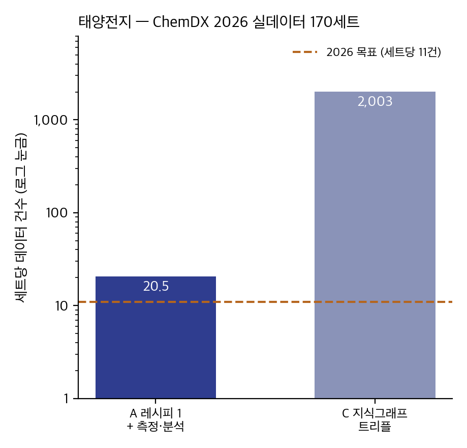
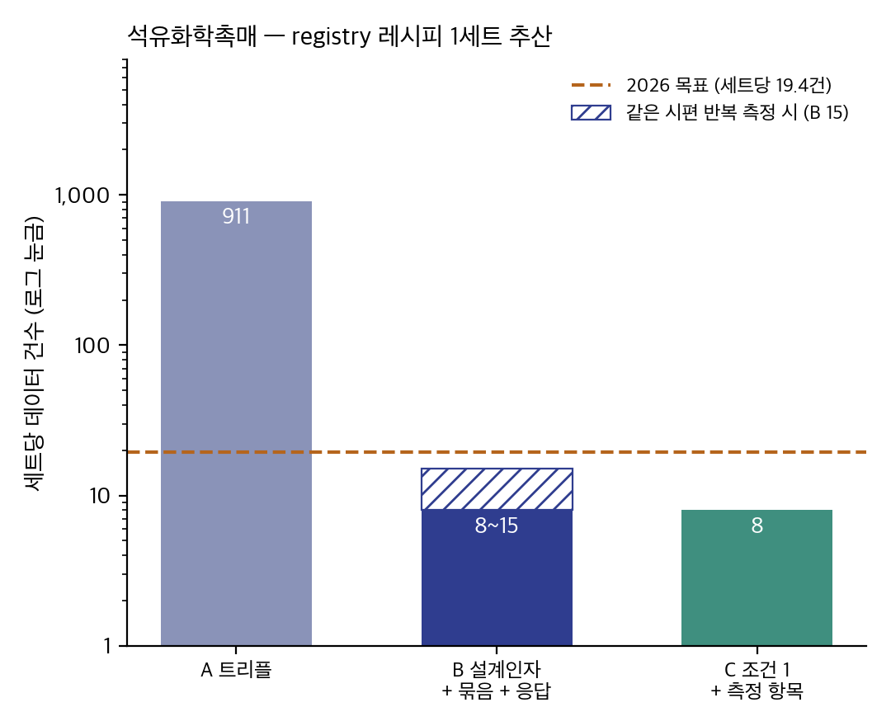

## 핵심요약

- 계획서: 2026년 455세트·5,900건(5년 10만 건)
- 칸이 아니라 정보의 단위로 데이터를 세는 정의가 필요.

| 안 | 1건 | 산식 | 태양전지 예시 (170세트) | 세트당 |
|---|---|---|---|---|
| A | 지식그래프 트리플 하나 | 트리플 수 | 340,431 | 2,003 |
| B | 고정/변동 인자 묶어서 1 설계인자 각 1 응답인자 각 1 | 1 + Σ설계인자 + Σ시편Σ항목 min(n, 2) | 6,695 | 39.4 |
| C | 조건 전체 1 · 측정 항목 하나 | 1 + 측정 항목 수 | 1,850 | 10.9 |
| 계획서 | | | 300세트 · 3,300 | 11.0 |

## 올해 목표와 비교 — 세트당 데이터 건수

- 세트당 데이터 건수

태양전지/ 석유화학촉매 추산(예시)

## 1. 세트 = 실험 ID

- 실험 ID 하나 = 1세트. 합성·측정·분석이 다른 레시피나 다른 랩에서 이루어지면 별도 세트로 두고 시료 ID로 잇는다.
- 근거: 온톨로지 W3C PROV-O와 같은 기준(시료 = entity, 합성·측정 = activity).
- 태양전지 예: 레코드 1건(소자 제작 + JV) = PSC-EXP-20260213-007 1세트. 이 소자의 XRD를 분석 별도 랩에서 수행하면 추가 세트가 따로 생김.

## 2. (X·Y) 구분은 모델의 역할

- 정방향 설계(조성·공정 → 물성)와 역설계(목표 물성 → 조성)는 x·y를 바꿔 씀\*
- 자율실험실에서는 공정 실측값도 스스로 보정할 수 있음(예: 레시피 3 g → 실제 3.1 g → 토출 시간 조절). 그래서 "Y로 쓰이는 것"을 기준으로 세면 과제마다 숫자가 달라진다.
- 태양전지 예: "이 조성이면 PCE가 몇 %인가"(조성 = X)와 "PCE 25%를 내는 조성은 무엇인가"(조성 = Y)의 차이.
    - 근거: Sanchez-Lengeling & Aspuru-Guzik, Science 2018

## 3. 응답인자, 설계인자, 고정·변동 인자

- 실험계획법(DoE)의 인자 분류를 따른다.\*
    - 응답인자(response factor) = 실험의 결과값(소재 물성/성능 측정-분석값) → 각 1건, 조성·구조·공정·물성/성능 범주로.
    - 설계인자(design factor) = 실험에서 일부러 바꾸는 것 → 각 1건, 조성·구조·공정 범주별로.
    - 고정 인자(held-constant) = 일부러 고정한 것 + 변동 인자(allowed-to-vary·nuisance) = 통제하지 않았는데 바뀐 것 → 묶어서 1건.
- 스케일업 관점의 예시: 태양전지의 면적, 촉매의 무게에 따라 물성이 바뀌고, 스케일업 관점에서는 해당 데이터는 주요한 설계인자.
- 판정 = 랩이 선언한 것 ∪ 실데이터에서 세트마다 값이 달라진 것. 환경 조건·장비 운용값·측정 설정은 묶음으로, 규모(면적·질량)는 설계인자로 둔다. 데이터팀이 1차 분류하고 랩이 확인한다.
    - Montgomery, Design and Analysis of Experiments: 같은 변수는 제로 엔트로피로 학습 신호가 없음. 하지만 재현에 필요하므로 1로 셈(FAIR 원칙).

- 태양전지 예: 공정 파라미터 자리 128개 중 106개는 같은 값(고정인자), 실험실 온도·습도·스캔 방향(변동 인자) → 묶음 1건. 나머지 값이 바뀐 설계인자는 19개(PVK 스핀 속도·시간, 용매와 양, HTL 도펀트, 표면처리 재료·농도, 측정 면적, 페로브스카이트 화학식 등) → 세트당 설계인자 18.9건.

## 4. 응답인자(물성·성능)은 각 1건, 파일도 1건

- 응답 = 측정 결과 하나. 파일과 그 파일에서 뽑은 숫자를 둘 다 센다. 파일마다 규칙을 두면 소재 분야마다 규칙을 계속 추가해야하고 추적관리가 불가능함.
- 랩이 '공정'으로 표기한 실측값(칭량 질량 등)은 한 묶음으로.
- 태양전지 예: JV 측정 하나 = 곡선 파일 1 + PCE·Jsc·Voc·FF 4 = 응답 5. 스캔방향(정·역) 고려하면 10.

## 5. 시편마다 1건, 같은 시편의 반복 측정은 2건

- 시편 = 측정 대상. 다른 시편은 각 1건. 같은 시편을 반복 측정하면 n과 무관하게 2건(값 + 불확도).\*
- 같은 시편이라도 다른 시점·조건에서 잰 것(숙성 일수, 전지 사이클, 스캔 방향)은 독립 시편.
    - 반복측정을 하면 1회 측정과는 다른 측정결과와 불확도를 표현할 수 있음. n이 커지면 정밀도가 높아지지만 그 값의 개수는 늘어나지 않음. 100번을 재도 2건이라 부풀릴 수 없고, 반복 자체에는 1건을 더 줘 불확도를 확보하고, 좋은 성능만 보려는 편향을 줄이는데 도움이됨.(Hurlbert 1984, Ecological Monographs 54(2), 187–211)

- 태양전지 예: 같은 셀을 JV 10번 → PCE 2건. 셀 8개를 1번씩 → 8건(셀마다 개체로 등록됐을 때). 지금 ChemDX 데이터는 픽셀이 소자 개체 하나의 반복으로 들어가 있어 2건으로 센다 → 세트당 응답 19.5건(픽셀을 개체로 나누면 67.9). 시편 단위의 공통 원칙은 전 실험실 실데이터를 확인한 뒤 정한다.
